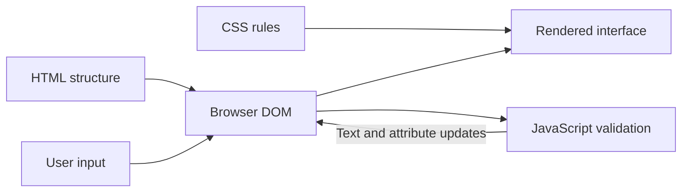
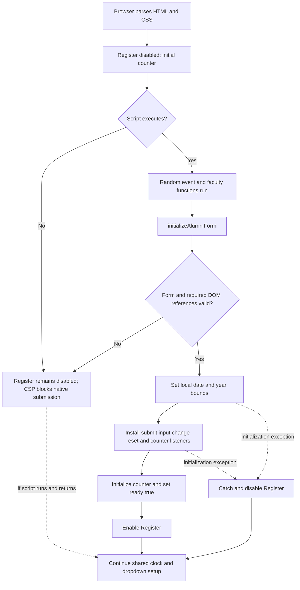
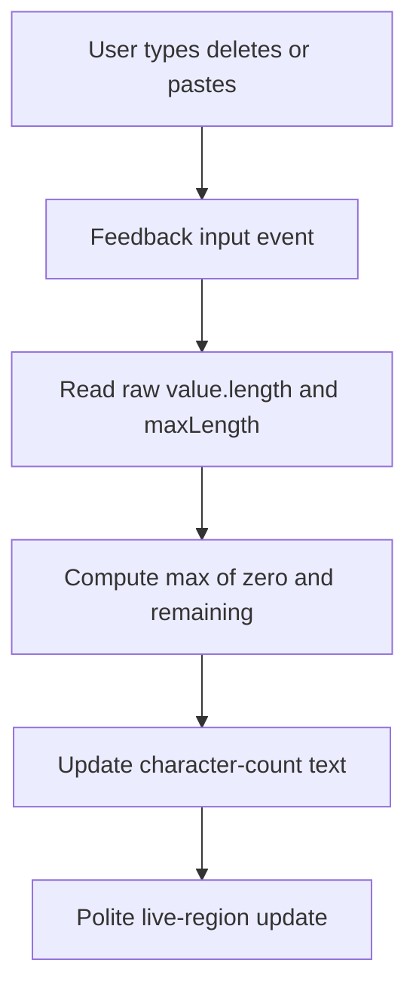
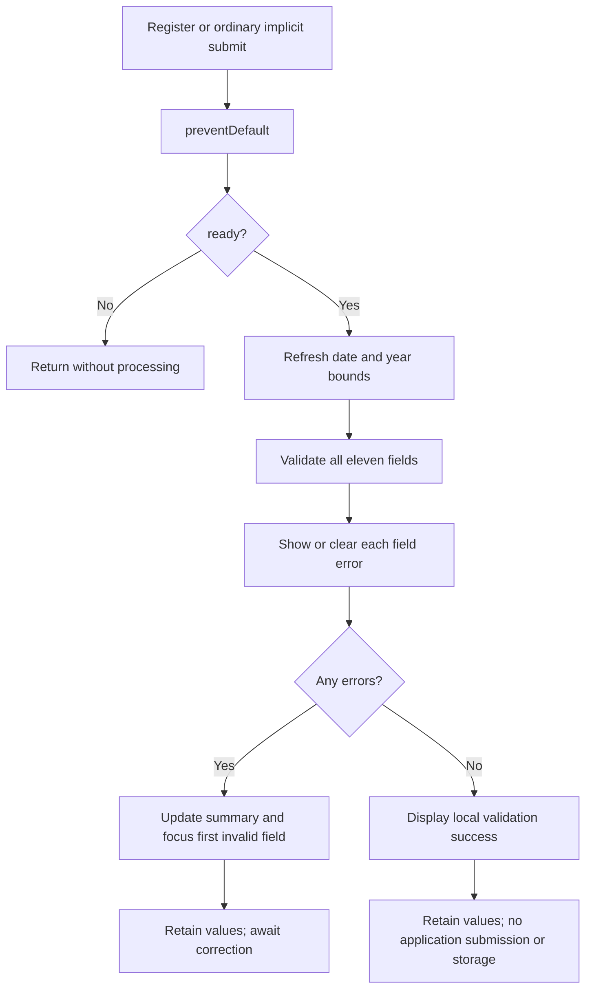
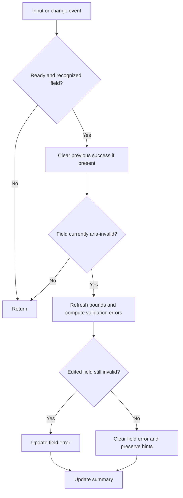
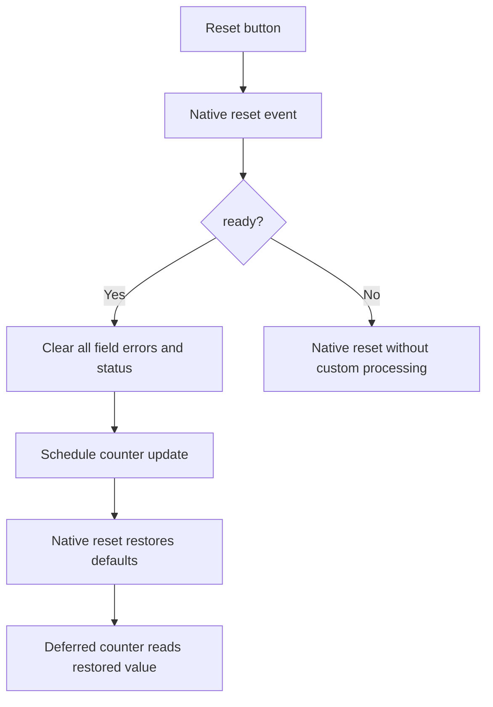

# Code Comprehension and Walkthrough
## Assignment 2: Designing and Validating an Alumni Registration Form Using AI-Assisted Development

**Department of Computer Science — University of Delhi**  
**M.Sc. Computer Science | Web Development and Prompt Engineering**  
**Version:** 1.0 | **Date:** 26 November 2026  
**Location:** `assignment-2/CODE_WALKTHROUGH.md`  
**Status:** Source walkthrough completed; formal verification pending.

This document explains the finalized implementation, not a proposed redesign. Source references H, C and J below use one-based physical line numbers. SRS and test identifiers retain their approved numbering. The updated audit Section 20 records six source corrections, preliminary manual checks reported successful by the developer without individual screenshots, and pending formal execution. The original audit remains historical evidence.

| Alias | Reviewed upload | SHA-256 |
|---|---|---|
| H | `alumni(20261126-142043).html` | `a10c22dc0f01e38bba775b1c15ad3fa8abc70e080fb1823e3567cb110738bd84` |
| C | `style(20261126-142043).css` | `a83fa826271b915e58e5b0fe9e4d8ece63b81b20e1afabd962840784764da8bf` |
| J | `script(20261126-142044).js` | `72455bd123d54064b93cf630e7c21930cc39ad8ab8faba5812befa33878597d0` |
| S | `SRS(20261126-142058).md` | `01b49a9f3bb5763192397b0bcc6dbc01eed2a5af43ef330878babfb5789e975f` |
| T | `ASSIGNMENT_TEST_PLAN(20261126-142058).md` | `d88493e515179113ce31db30c228beefb37013b99f32782f0d65e03e2b4d1ed4` |
| A | `CONFORMANCE_AUDIT(7).md` | `1bfc8735c1ff17150a21d0c9847563897e30b8a2390f22f5acffc95a2e1824ee` |

## 1. Project Architecture

The module extends the Assignment 1 departmental website rather than replacing it. The browser loads three cooperating layers:

| File | Responsibility | Interaction |
|---|---|---|
| `alumni.html` | Semantic structure, controls, constraints and accessible message placeholders | Links `style.css` in the head (H13) and loads `script.js` at the end of the body (H247). |
| `style.css` | Shared departmental appearance and alumni-specific layout and states | Selects classes and attributes defined by HTML and updated by JS. |
| `script.js` | Local validation, feedback count, event handling and shared website interactions | Reads DOM values, sets attributes and writes text into existing elements. |



No backend endpoint, database, authentication, OTP or application-managed persistent storage is implemented. The form values remain in browser controls during the interaction. Loading static resources is not registration-data transmission. Register means validate locally, not create an alumni record. The SRS excludes real registration (S section 2.4). The homepage and timetable are linked, but their current complete source and separate jQuery script are not among these six uploads.

## 2. HTML Code Walkthrough

### 2.1 Page structure and landmarks (H1–58, 230–250)

`<!doctype html>` selects standards mode; `lang="en"` identifies the document language; UTF-8 supports text encoding; viewport metadata allows mobile layout to use device width. The header contains university and department headings. `nav.alumni-nav` has an accessible name and links Home, Alumni Registration and Timetable; `aria-current="page"` identifies the current page. `main` encloses `section.alumni-section` and its heading. The footer identifies the educational project and disclaims official university status. The script is loaded after the form markup, so normal synchronous execution can find its elements.

### 2.2 Form groups and controls (H57–224)

`form#alumni-form.alumni-form` has `novalidate`: the browser does not perform its automatic interactive validation on submission, allowing the custom handler to present consistent errors. Native constraints remain useful for input semantics and editing; JavaScript enforces the final rules. Each of four fieldsets has a legend. A label's `for` matches the control's unique `id`, while `name` identifies the form field. Visible required/optional wording complements the attributes.

| Group | Label / ID | Type and HTML constraints | Final JS rule | H lines |
|---|---|---|---|---|
| Personal | Full Name / `full-name` | text, required, minlength 3, autocomplete name | Trim; minimum 3, no alphabet-only rule | 63–69 |
| Personal | Email Address / `email` | email, required, autocomplete email | Trim; native syntax plus one @, dotted domain and no internal whitespace | 71–76 |
| Personal | Contact Number / `phone` | tel, required, pattern, inputmode numeric, autocomplete tel-national | Trim; exactly ten ASCII digits, leading zero allowed | 78–89 |
| Personal | Date of Birth / `dob` | date, required, min 1900-01-01, autocomplete bday | Real Gregorian date, through local today | 91–97 |
| Academic | Academic Batch / Year of Passing / `batch` | number, required, min 1980, step 1 | Exactly four digits, through current local year | 103–112 |
| Academic | Course / Department / `degree` | required select | Nonempty approved value: bsc, msc, mca, phd, other | 114–125 |
| Professional | Current Designation / `designation` | text, required, minlength 2, autocomplete organization-title | Trim; minimum 2 | 131–141 |
| Professional | Organization / Company Name / `organization` | text, required, minlength 2, autocomplete organization | Trim; minimum 2 | 143–153 |
| Professional | Current Location / `location` | text, required, minlength 2, autocomplete address-level2 | Trim; minimum 2 | 155–164 |
| Additional | About Yourself / `about-yourself` | textarea, rows 4, minlength 10, optional | Blank after trim accepted; otherwise minimum 10 | 170–180 |
| Additional | Alumni Feedback / `feedback` | textarea, rows 4, required, minlength 10, maxlength 300 | Trimmed minimum 10; raw maximum 300 UTF-16 units | 184–204 |

The course placeholder has empty value; it is not a valid selection. Professional hints allow Student, Unemployed, Retired or Self-employed and organization alternatives Not applicable, Independent or Self-employed. These are examples, not a restricted list. Location requests city or city/country, not a full address. No age or employment verification is implemented.

### 2.3 Attributes and accessibility

`required` expresses mandatory status; `minlength` and `maxlength` describe length constraints, and `min`, `max`, `step` constrain dates/numbers. `pattern` on phone permits surrounding whitespace around exactly ten ASCII digits, matching the JS trimming policy. `inputmode` suggests a numeric keyboard without guaranteeing numeric input. `autocomplete` gives browsers semantic autofill hints; it does not implement storage. `aria-describedby` connects persistent hints to controls and is extended dynamically with error IDs. Placeholder text is supplementary, not a replacement for labels.

Example from H78–89:

```html
          <div class="form-group">
            <label for="phone">Contact Number (required)</label>
            <input type="tel" id="phone" name="phone"
              pattern="\s*[0-9]{10}\s*" autocomplete="tel-national"
              inputmode="numeric" aria-describedby="phone-hint"
              placeholder="10-digit mobile number" required>
            <p id="phone-hint">
              Enter exactly 10 digits (0–9), without a country code,
              internal spaces or symbols. Leading zeroes are allowed.
            </p>
            <p id="phone-error" class="field-error" hidden></p>
          </div>
```

### 2.4 Feedback and messages (H184–210)

The counter starts at 0 entered and 300 remaining. The textarea references both `feedback-hint` and `character-count`. `aria-live="polite"` requests announcements without interrupting current speech; `aria-atomic="true"` requests the whole updated message. Eleven hidden paragraphs with IDs of the form `<field-id>-error` hold field-specific messages. `#form-message` has `role="status"`, polite live updates and atomic announcements. These are accessibility mechanisms, not proof of screen-reader behavior.

```html
            <textarea id="feedback" name="feedback" rows="4"
              minlength="10" maxlength="300"
              placeholder="Share your feedback about the department"
              aria-describedby="feedback-hint character-count"
              required></textarea>

            <p id="feedback-hint">
              Enter at least 10 characters after trimming leading and
              trailing whitespace. Feedback must not exceed 300 characters
              in total.
            </p>

            <p id="character-count" class="character-count"
              aria-live="polite" aria-atomic="true">
              0 characters entered | 300 characters remaining
            </p>
            <p id="feedback-error" class="field-error" hidden></p>
```

### 2.5 Fail-safe registration (H7, 48–58, 215–221)

The persistent `#demo-notice` explains no submission/storage and fictional data; the form references it. `noscript` displays a notice when scripting is disabled, not necessarily when an external script is blocked. Register is a disabled submit button until JS completes initialization; Reset is a native reset button. The CSP meta directive `form-action 'none'` prohibits form submissions in supporting browsers, including ordinary native fallback. It does not prohibit all network requests or provide production security. No action or method is specified, which alone would not prevent native submission.

```html
      <p id="demo-notice">
        <strong>Academic demonstration:</strong> This frontend form does not
        submit or store registration information. Use fictional sample
        information only.
      </p>
      <noscript>
        <p>JavaScript is unavailable. Registration validation is disabled.</p>
      </noscript>

      <form class="alumni-form" id="alumni-form"
        aria-describedby="demo-notice" novalidate>
```

```html
          <button type="submit" id="register-button" disabled>
            Register
          </button>

          <button type="reset">
            Reset
          </button>
```

## 3. CSS Code Walkthrough

### 3.1 Visual identity and scoping

The shared body rule (C389–395) sets Arial/Helvetica/sans-serif, pale background and dark text. Alumni header (C941–963) uses navy `#14345a`, white headings and centered text. Navigation (C968–987) uses `#234f7b`, Flexbox and visible hover/focus underlining. Section rules (C992–1011) center the heading and introductory paragraphs, including the demonstration notice. Form-specific rules are prefixed `.alumni-form`, so unrelated timetable and homepage controls are not automatically restyled. Shared global styles still apply intentionally.

### 3.2 Layout and control styling

| Selector / C lines | Explanation |
|---|---|
| `.alumni-form` 1015–1026 | Width 100%, max 760px, centered with auto margins; 32px padding, white background, border, rounded corners and subtle shadow. |
| `.alumni-form fieldset` 1030–1039 | Bordered groups, 24px padding, 26px bottom margin; min-width 0 and max-width 100% help avoid overflow. |
| `.alumni-form legend` 1041–1051 | Bold navy 18px heading; normal whitespace and overflow wrapping. |
| `.alumni-form .form-group`, `label` 1055–1072 | Consistent vertical spacing, block labels, readable weight and wrapping. |
| `.alumni-form input`, `select`, `textarea` 1076–1095 | Full-width block controls, 46px minimum height, 12px padding, 16px font, border-box sizing. |
| Placeholder/textarea/hints 1097–1116 | Muted placeholder, vertical textarea resizing, 110px minimum height, persistent 13px hints. |
| Hover/focus 1120–1133 | Border change and 2px outline with offset; focus is visible without relying solely on color. |
| `.form-buttons`, buttons 1138–1163 | Flexbox with wrapping, 14px gap; buttons grow/shrink from 140px basis. |
| Submit/reset states 1165–1203 | Navy primary and light secondary; hover/active feedback only when enabled. |
| Button focus/disabled 1205–1220 | Keyboard outline and muted disabled state with not-allowed cursor. |

`box-sizing: border-box` includes padding and border in the specified width, reducing accidental overflow. `min-width: 0` allows shrinking; wrapping rules help long text remain inside its container.

```css
.alumni-form {
  width: 100%;
  max-width: 760px;
  min-width: 0;
  margin: 0 auto;
  padding: 32px;
  background-color: #ffffff;
  border: 1px solid #dce3eb;
  border-radius: 12px;
  box-shadow: 0 4px 15px rgba(0, 0, 0, 0.07);
  box-sizing: border-box;
}
```

### 3.3 Responsive design

| Breakpoint | Changes |
|---|---|
| Default | Centered max-760px form; buttons share a row where space permits. |
| <=768px (C1217–1229) | Reduced section, form and fieldset padding. |
| <=600px (C1233–1301) | Smaller heading/legend, wrapping alumni navigation, reduced padding, stacked full-width buttons. |
| <=375px (C1305–1325) | Further reduced padding and 15px legend. |

The rules cascade: at 320px all three narrower conditions apply. This is responsive CSS, not device detection. Native date/select widgets and zoom can behave differently across browsers. Formal tests cover 1440, 1280, 1024, 768, 425, 375 and 320px; preliminary responsive success is developer-reported.

### 3.4 Counter, errors and success (C1528–1604)

`.alumni-form .character-count` right-aligns the count and permits wrapping. Attribute selectors for `[aria-invalid="true"]` apply red border, pale red background and inset shadow. `.field-error` supplies red text and weight; `[hidden]` explicitly removes it from display. `.form-message:empty` removes unused margin. `.form-message.error` and `.form-message.success` provide distinct colored backgrounds, borders and text. Actual message text communicates the state even without color. Contrast and assistive-technology checks remain formal tasks.

```css
.alumni-form input[aria-invalid="true"],
.alumni-form select[aria-invalid="true"],
.alumni-form textarea[aria-invalid="true"] {
  border-color: #b42318;
  background-color: #fff8f7;
  box-shadow: inset 3px 0 0 #b42318;
}


/* Field-Specific Validation Messages */

.alumni-form .form-group > .field-error {
  margin: 7px 0 0;
  color: #b42318;
  font-size: 13px;
  font-weight: 600;
  line-height: 1.6;
  overflow-wrap: anywhere;
}

.alumni-form .form-group > .field-error[hidden] {
  display: none;
}
```

## 4. JavaScript Code Walkthrough

### 4.1 Initialization and scope

`initializeAlumniForm()` (J108–691) contains all alumni helpers and state. It returns immediately if `#alumni-form` is not an HTMLFormElement, or Register is not an HTMLButtonElement. It explicitly disables Register, sets `ready = false`, and obtains form-scoped references. `fields` maps all 11 IDs to DOM controls; `fieldIds` preserves their order. `errorContainers` maps each ID to its matching error paragraph. The `every` callback verifies input/select/textarea class, form ownership and presence of each error element. Counter, status and submit button ownership/type are checked separately. Missing nodes cause an early return, leaving Register disabled.

```javascript
  const fieldIds = Object.keys(fields);
  const errorContainers = {};
  fieldIds.forEach(function (fieldId) {
    errorContainers[fieldId] = alumniForm.querySelector(`#${fieldId}-error`);
  });

  const controlsValid = fieldIds.every(function (fieldId) {
    const field = fields[fieldId];
    const expectedType = fieldId === "degree" ? HTMLSelectElement :
      fieldId === "feedback" || fieldId === "about-yourself" ?
        HTMLTextAreaElement : HTMLInputElement;
    return field instanceof expectedType && field.form === alumniForm &&
      errorContainers[fieldId] instanceof HTMLElement;
  });

  if (!controlsValid || !(characterCount instanceof HTMLElement) ||
      !(formMessage instanceof HTMLElement) ||
      registerButton.form !== alumniForm || registerButton.type !== "submit") {
    return;
  }
```

The guard checks element classes, not every individual input subtype or all hint nodes. Constants define minimum birth date, minimum graduation year, maximum feedback length and approved courses (J125–135). Dynamic constraints are initialized before listeners; submit, delegated input/change, reset and feedback input listeners are installed before `ready` becomes true and Register is enabled (J588–690). The outer try/catch (J693–702) disables Register on initialization exceptions and avoids logging personal data. It does not catch every possible later event-handler exception.

### 4.2 Function-by-function reference

| Actual function | Lines | Purpose, inputs and output |
|---|---|---|
| `initializeAlumniForm()` | 108–691 | Initializes scoped DOM references, helpers and listeners; no return value used. |
| `updateFeedbackCounter()` | 174–189 | Reads textarea maxLength and raw value.length; updates counter text, clamps remaining at zero. |
| `getLocalDateString(date)` | 193–199 | Returns local YYYY-MM-DD using getFullYear/getMonth/getDate and padStart. |
| `updateDateAndYearConstraints(today)` | 201–204 | Sets DOB and batch max attributes from local date/year. |
| `validateRequiredText(value, label, minimumLength = 1)` | 208–218 | Returns required/minimum-length message or empty string; caller trims. |
| `isValidEmail(value)` | 222–255 | Boolean: rejects whitespace, checks one @ and nonempty parts, dotted domain, then detached native email input validity. |
| `isValidContactNumber(value)` | 259–261 | Boolean: anchored ten ASCII digit regex. |
| `isValidDOB(value, today)` | 265–304 | Boolean: fixed format, bounds, leap-year/month/day validity. |
| `isValidGraduationYear(value, today)` | 308–319 | Boolean: exactly four digits then numeric range. |
| `isValidCourse(value)` | 323–325 | Boolean: membership in approvedCourses. |
| `validateAlumniForm(today)` | 329–462 | Reads all controls and returns an object keyed by invalid field IDs. |
| `addError(fieldId, message)` | 333–337 | Nested helper; stores only nonempty messages in errors. |
| `updateErrorAssociation(field, errorId, hasError)` | 468–489 | Uses Set to preserve existing description tokens while adding/removing error ID. |
| `showFieldError(fieldId, message)` | 493–507 | Writes message, unhides paragraph, sets aria-invalid and associates error. |
| `clearFieldError(fieldId)` | 511–525 | Clears/hides paragraph, removes aria-invalid and only the error description. |
| `displayValidationErrors(validationErrors)` | 529–540 | Iterates all field IDs, showing or clearing each error. |
| `clearAllFieldErrors()` | 544–546 | Applies clearFieldError to every field. |
| `clearFormMessage()` | 550–553 | Clears status text and restores base class. |
| `showFormMessage(message, messageType)` | 555–562 | Sets status class and updates text only if changed. |
| `updateValidationSummary()` | 566–584 | Counts displayed invalid fields; clears summary at zero, otherwise singular/plural message. |
| `handleFieldModification(event)` | 629–667 | Delegated input/change handling; clears stale success, revalidates currently invalid field and updates summary. |

The submit and reset callbacks are anonymous functions, not additional named functions. `forEach`, `every`, `filter` and `some` callbacks support iteration and predicates; they are not separate public APIs.

### 4.3 Character counter

```javascript
    const maxLength = feedback.maxLength;
    const enteredCharacters = feedback.value.length;
    const remainingCharacters = Math.max(
      0,
      maxLength - enteredCharacters
    );

    characterCount.textContent =
      `${enteredCharacters} characters entered | ` +
      `${remainingCharacters} characters remaining`;
```

For 25 ASCII characters the display is 25 entered / 275 remaining; at 300 it is 300 / 0. Deleting characters increases remaining. JS string length counts UTF-16 code units, so a supplementary emoji may count as two, not one visual character. Native maxlength normally restricts typing/paste, but programmatic values can exceed it; the counter clamps remaining while validation rejects excess. The counter is initialized and updated on input (J686–687), and after reset (J683).

### 4.4 Date, year and field validators

`getLocalDateString` avoids UTC conversion when calculating today. `updateDateAndYearConstraints` runs at initialization, submission and revalidation of currently invalid fields. `validateRequiredText` receives trimmed strings for name, designation, organization, location and feedback; empty strings return a required error before length checking. Email and phone are also trimmed before validation. The detached email input uses browser syntax validation without sending an email or making a request. `isValidContactNumber` treats phone as text, preserving a leading zero.

```javascript
  function isValidContactNumber(value) {
    return /^[0-9]{10}$/.test(value);
  }
```

```javascript
    const [year, month, day] = value.split("-").map(Number);

    const isLeapYear =
      year % 400 === 0 ||
      (year % 4 === 0 && year % 100 !== 0);

    const daysInMonth = [
      31,
      isLeapYear ? 29 : 28,
      31,
      30,
      31,
      30,
      31,
      31,
      30,
      31,
      30,
      31
    ];

    return (
      month >= 1 &&
      month <= 12 &&
      day >= 1 &&
      day <= daysInMonth[month - 1]
```

The leap-year rule accepts years divisible by 400 or divisible by 4 but not 100. Thus 2000-02-29 is valid and 1900-02-29 is not. The fixed-width date format allows chronological string comparison against the minimum and local today. Graduation year first rejects decimal/exponent strings with its four-digit regex, then converts to number and checks 1980 through the current year. Native date/number inputs may sanitize attempted invalid values before JS sees them; record the actual DOM value in tests. Course validation uses `approvedCourses.includes(value)` and rejects the empty placeholder or injected unapproved values.

### 4.5 Comprehensive validation (J329–462)

`validateAlumniForm(today)` creates a fresh errors object. It validates personal fields (J341–373), academic fields (J377–397), professional fields (J401–426), optional About Yourself (J430–438) and feedback (J442–459). It does not stop at the first invalid field. The optional field is accepted when trimmed empty; otherwise at least 10 characters are required. Feedback checks raw maximum first and then trimmed required/minimum length. For example, 301 raw units with surrounding spaces still fail; nine meaningful characters plus spaces also fail. The returned object contains one message per invalid field; an empty object means all local rules passed.

```javascript
    const about = fields["about-yourself"].value.trim();

    if (about && about.length < 10) {
      addError(
        "about-yourself",
        "About Yourself must contain at least 10 characters " +
        "when provided."
      );
    }

    /* Alumni Feedback */

    const rawFeedback = fields.feedback.value;
    const trimmedFeedback = rawFeedback.trim();

    if (rawFeedback.length > maximumFeedbackLength) {
      addError(
        "feedback",
        `Alumni Feedback cannot exceed ${maximumFeedbackLength} characters.`
      );
    } else {
      addError(
        "feedback",
        validateRequiredText(
          trimmedFeedback,
          "Alumni Feedback",
          10
        )
      );
    }
```

### 4.6 Accessible errors and status

`updateErrorAssociation` splits the current `aria-describedby` into tokens, removes empty tokens and stores them in a Set. Adding `feedback-error` preserves `feedback-hint character-count`; clearing the error removes only `feedback-error`. When no tokens remain, the attribute is removed. `showFieldError` uses `textContent`, not HTML insertion, and sets `hidden = false` and `aria-invalid="true"`. CSS reacts to this attribute. `clearFieldError` reverses these changes. `displayValidationErrors` processes every field; `clearAllFieldErrors` is used on reset. `updateValidationSummary` counts currently displayed invalid fields rather than independently validating every value. `showFormMessage` avoids unnecessary repeated text changes; `clearFormMessage` removes stale status styling.

```javascript
  function showFieldError(fieldId, message) {
    const field = fields[fieldId];
    const errorContainer = errorContainers[fieldId];

    errorContainer.textContent = message;
    errorContainer.hidden = false;

    field.setAttribute("aria-invalid", "true");

    updateErrorAssociation(
      field,
      errorContainer.id,
      true
    );
  }
```

### 4.7 Submission, modification and reset

The submit listener (J592–625) calls `event.preventDefault()` before checking `ready`, refreshes constraints, validates all fields and displays errors. If errors exist, it updates the summary, focuses the first invalid field in `fieldIds` order and returns. Values are not cleared. Otherwise it displays the explicit success message: “Form validated successfully! This is a demonstration; no data has been submitted or stored.” No request or persistence follows.

`handleFieldModification` ignores unrelated targets and unready state. It clears success after any recognized field edit. Only fields currently marked invalid are revalidated for immediate error correction; other fields are not prematurely marked. Although validation computes all errors, only the edited field's error is updated. A corrected field made invalid again may remain unmarked until Register is pressed (F-09); full submission still validates all fields.

The native reset button restores default values and the course placeholder. The reset listener clears errors and status, then schedules `setTimeout(updateFeedbackCounter, 0)` so the counter reads the reset values after the native reset action. Register stays enabled after successful initialization; reset is not a submission.

```javascript
  alumniForm.addEventListener("reset", function () {
    if (!ready) {
      return;
    }
    clearAllFieldErrors();
    clearFormMessage();

    // Update the counter after the native form reset completes.
    setTimeout(updateFeedbackCounter, 0);
  });

  updateFeedbackCounter();
  feedback.addEventListener("input", updateFeedbackCounter);
  // Enable registration only after all initialization steps succeed.
  ready = true;
  registerButton.disabled = false;
```

## 5. Execution Flow

### 5.1 Initial load and successful or failed initialization



On pages without the alumni form the initializer returns normally. If scripting is disabled, the noscript notice appears; if script loading fails, it may not appear, but HTML disabled state and CSP remain. An exception during initialization is caught; the form is not enabled. The diagram abstracts the normal synchronous sequence, not observed browser execution.

### 5.2 Feedback typing and deletion



The event also bubbles to the delegated form modification handler. A prior success is cleared; if feedback was invalid, its error is refreshed.

### 5.3 Invalid and valid submission



### 5.4 Correction and reset





## 6. Privacy, Accessibility and Reliability

Three complementary safeguards address ordinary submission: disabled Register in HTML, `preventDefault` in the installed submit handler, and CSP `form-action 'none'` on the alumni document. The readiness flag prevents processing by partially initialized handlers. The DOM guards and outer catch fail closed during initialization. No explicit registration fetch, XHR, beacon, storage or cookie operation appears in the reviewed code; values are not logged. `textContent` avoids interpreting displayed messages as markup. These safeguards do not prevent deliberate developer-tools changes, malicious scripts, browser extensions, browser-managed autofill/history or every possible network mechanism. CSP form-action is not a general network policy. Client-side checks are not a substitute for server-side validation in a real system.

Accessibility combines semantic groups, associated labels, visible required wording, persistent instructions, live regions, invalid attributes, text messages and focus management. Error correction preserves instructional descriptions. Keyboard focus is styled; formal keyboard and screen-reader behavior, contrast and responsive overflow must still be tested. Native date/number/email handling, local clock accuracy, browser CSP support and restored form state can vary. The guard is designed for initialization, not arbitrary DOM mutations after initialization or repeated manual invocation of the initializer.

## 7. Post-Audit Improvements

The following explains the original findings from A section 15 and the corrected evidence from A section 20. Source correction is not formal closure.

| Finding | Original root cause | Correction and benefit | Current evidence |
|---|---|---|---|
| F-01 Critical | Enabled submit and no explicit native-submission protection before JS listener | Disabled default, CSP, ready gate and preventDefault reduce native fallback risk | H7,215; J118,592–596,688–690 |
| F-02 High | Form-only guard allowed missing controls/messages to throw | Scoped typed DOM checks, early return, isolated initializer and catch | J108–170,693–702 |
| F-03 Medium | Missing joining-date could throw on split | Check presence and YYYY-MM-DD format before split; skip bad member | J60–85 |
| F-04 Low | closest could return null before classList access | Return when dropdown parent missing | J774–780 |
| F-05 Low | No persistent pre-entry no-data notice | Notice and form association; fictional-data instruction | H48–58 |
| F-06 Low | Trailing whitespace and unspaced child combinators | Clean blank line and spaced selectors; same CSS meaning | H181; C102,180–181 |

F-07 navigation refinement remains advisory; F-08 formal evidence remains open; F-09 revalidation policy remains unchanged. Original audit counts are not revised.

### 7.1 Shared website regression protection

`displayRandomEvent()` (J22–45) selects an event with Math.random and updates image src, alt and caption only if both nodes exist. `calculateFacultyExperience()` (J50–103) loops over `.faculty-experience`, checks joining-date presence/format, constructs a local Date and compares its components to reject impossible/future dates. It subtracts one year when the anniversary has not occurred and labels the result Sample. Invalid data affects only that member's callback.

```javascript
    const dateString = member.dataset.joiningDate;

    if (!dateString || !/^[0-9]{4}-[0-9]{2}-[0-9]{2}$/.test(dateString)) {
      member.textContent = "Invalid joining date";
      return;
    }

    const [year, month, day] = dateString
      .split("-")
      .map(Number);
```

`updateDigitalClock()` (J708–761) checks both clock/date elements, formats 12-hour time and local date, and updates machine-readable datetime. It runs immediately and starts a one-second interval when the clock exists (J763–769). Dropdown click handlers (J774–797) check the parent, close other menus, toggle `is-open` and update `aria-expanded`; the outside-click listener closes menus (J801–813). CSS hover/focus-within rules (C180–189) remain. The alumni initializer returns on pages without its form, and alumni selectors are scoped. These mechanisms reduce regression risk, but actual homepage assets, gallery, timetable, separate jQuery list/fade and repository preservation require full-site testing.

## 8. Requirements Traceability

The following table is generated from the actual SRS identifiers and the test plan's forward references. It lists major component requirement groups and every planned case that references at least one listed requirement. A case may appear in several rows. These are traceability links, not execution results.

| Component | SRS identifiers | Existing test case identifiers |
|---|---|---|
| Semantic structure | FR-01–08 | TC-FUN-001–002, TC-ACC-002 |
| Registration fields | FR-09–23 | TC-FUN-002, TC-FUN-005, TC-VAL-001–015, TC-VAL-018–064, TC-VAL-066–091 |
| Feedback and counter | FR-24–33 | TC-FUN-002–003, TC-VAL-016–017, TC-VAL-092–096, TC-CNT-001–014 |
| Validation | FR-34–44, VR-01–20 | TC-FUN-004, TC-VAL-001–097, TC-CNT-001–008, TC-CNT-011–013 |
| Accessible errors | FR-46–54, NFR-28–32 | TC-ERR-001–002, TC-ERR-005, TC-ACC-003 |
| Success and reset | FR-55–66 | TC-FUN-002–004, TC-CNT-014, TC-ERR-003–004, TC-PRIV-001 |
| Visual and responsive design | NFR-09–22 | TC-ERR-001, TC-ERR-005, TC-UI-001, TC-RES-001–007 |
| Keyboard and accessibility | NFR-23–27, NFR-33–37 | TC-FUN-001, TC-ERR-001, TC-ACC-001–002, TC-ACC-004 |
| Privacy and fail-safe | FR-45, NFR-55–63, SC-04, AC-41 | TC-FUN-003–004, TC-PRIV-001–006 |
| Shared features | FR-67–75 | TC-REG-001–012 |
| Maintainability and compatibility | NFR-42–54 | TC-VAL-097, TC-RES-001–007, TC-COMP-001–003, TC-STD-003–004, TC-DOC-003 |
| Standards | NFR-64–68 | TC-STD-001–004 |
| Walkthrough | AI-23–28, DR-07, AC-49 | TC-DOC-005 |

Ranges abbreviate consecutive existing identifiers. For precise individual mappings, consult the finalized test plan and its RTM. In particular TC-ERR-002 tests correction/retention, TC-ERR-003 stale success, TC-ERR-004 complete reset and TC-ERR-005 no premature errors. These descriptions follow the actual test plan even where the audit uses broader related retest references.

## 9. Code Comprehension Questions and Answers

**1. Why use semantic HTML?**

Landmarks and meaningful elements describe structure to browsers and assistive technologies.

**2. Why four fieldsets?**

They group personal, academic, professional and additional information; legends identify each group.

**3. How many fields are mandatory?**

Ten: nine registration controls plus feedback. About Yourself is optional.

**4. How are labels associated?**

The label for attribute equals the control id.

**5. Why use tel instead of number for phone?**

Phone is an identifier, not a quantity; text preserves leading zeros.

**6. Does inputmode enforce digits?**

No; it suggests a keyboard. The regex enforces digits.

**7. Why novalidate?**

It suppresses automatic submission-time native validation UI so the custom handler controls errors.

**8. Why is Register initially disabled?**

To prevent ordinary submission before validation is ready.

**9. What does CSP form-action none do?**

It blocks form submission destinations in supporting browsers, not every network request.

**10. When is noscript visible?**

When scripting is disabled; blocked external JS alone need not display it.

**11. Why use scoped CSS?**

It reduces unintended changes to other pages sharing the stylesheet.

**12. What is border-box?**

Specified width includes padding and border.

**13. How are buttons responsive?**

Flexbox wraps them by default and stacks them at <=600px.

**14. What happens at 320px?**

All three alumni media queries apply, reducing padding and legend size.

**15. How is invalid styling activated?**

JS sets aria-invalid=true; CSS attribute selectors match it.

**16. Why use visible focus outlines?**

Keyboard users need to locate the active control.

**17. What does initializeAlumniForm do?**

Checks required DOM references, prepares helpers and listeners, then enables Register.

**18. What is ready?**

A local Boolean flag that permits processing only after initialization.

**19. Why use form.querySelector?**

It scopes lookup to the form rather than unrelated page nodes.

**20. What if dob is missing?**

The controlsValid check fails and initialization returns with Register disabled.

**21. How is feedback counted?**

Raw value.length and maxLength; remaining is clamped at zero.

**22. Does an emoji always count as one?**

No. JS length counts UTF-16 units; supplementary characters often use two.

**23. Why trim text?**

Whitespace-only required values should fail and surrounding spaces should not inflate minimum length.

**24. How is email checked?**

One @, nonempty parts, dotted domain, no whitespace and native email validity.

**25. Is email ownership verified?**

No. Syntax checking does not prove an address exists.

**26. How is leap year calculated?**

Divisible by 400 or by 4 but not 100.

**27. Why use local date instead of ISO UTC?**

The approved boundary is the browser local calendar date.

**28. Why regex before Number for batch?**

To reject decimal/exponent forms and enforce exactly four digits.

**29. How is course validated?**

The value must be in approvedCourses; the empty placeholder fails.

**30. What if About Yourself is all spaces?**

After trimming it is empty and accepted because optional.

**31. What if feedback is 301 raw units?**

It fails maximum validation even if trimming reduces length.

**32. Why collect errors in an object?**

One message per field permits displaying all errors in one submission.

**33. Why use Set for aria-describedby?**

It preserves hint tokens and prevents duplicate error tokens.

**34. Why textContent rather than innerHTML?**

Messages are inserted as text rather than interpreted markup.

**35. What does preventDefault do?**

Cancels the submit event default action before local validation.

**36. How is first invalid field selected?**

Filter fieldIds in insertion order and focus the first matching field.

**37. What happens on successful validation?**

A demonstration success message appears and values remain; no registration record is created.

**38. Why revalidate only currently invalid fields?**

To give correction feedback without premature errors; renewed invalid edits may wait until submit.

**39. Why setTimeout on reset?**

The reset event precedes restoration of native defaults; deferred counting reads restored values.

**40. What does the outer catch protect?**

Initialization exceptions; it disables Register without logging data or stopping later shared setup.

**41. How is faculty date failure handled?**

Missing/malformed dates are rejected before split; component checks reject impossible/future dates.

**42. Why guard closest?**

An orphan dropdown toggle may have no matching parent; null must not be dereferenced.

**43. How would you debug a failed initialization?**

Use disposable local page, fictional data, breakpoints and Elements/Console; inspect missing nodes and disabled state.

**44. How would you verify no data transmission?**

Inspect Network, URL and Storage during valid/invalid/reset and failure scenarios; static inspection alone is insufficient.

**45. What is regression testing?**

Rechecking existing website features after modifications.

**46. What is the role of SRS and RTM?**

SRS defines approved behavior; RTM connects requirements to planned cases.

**47. Why distinguish AI audit from browser tests?**

Static review identifies source evidence and risks but cannot establish observed runtime behavior.

**48. What is the AI-assisted workflow?**

Requirements, test plan, incremental implementation, audit, corrections, walkthrough, manual verification and submission evidence.

**49. Has W3C validation passed?**

No result is supplied; official HTML/CSS validation remains pending.

**50. Can this form be used for real registration?**

No. Real registration requires server-side processing, security, privacy and storage decisions outside scope.

## 10. Conclusion

The finalized alumni module demonstrates semantic HTML, scoped responsive CSS, event-driven JavaScript, boundary validation, accessible error feedback and fail-safe local initialization. The key decisions are to preserve Assignment 1, use one comprehensive validation routine, distinguish raw and trimmed feedback lengths, retain instructional ARIA associations, and prohibit ordinary native submission rather than simulate a backend. The learning outcomes include DOM manipulation, regular expressions, Gregorian calendar validation, Flexbox, responsive design, debugging, requirements traceability and disciplined AI-assisted development.

The updated audit records F-01–F-06 source corrections, retained advisories F-07/F-09 and open evidence finding F-08. Developer-reported preliminary checks are not independently observed formal results. All 168 cases in the supplied plan remain Not Tested; complete browser, accessibility, privacy, regression and W3C evidence is still required. The final testing report, candidate revision, ZIP and public transcript must be verified according to the SRS. This walkthrough does not modify source, SRS, test plan or audit and does not certify production security or submission readiness.
